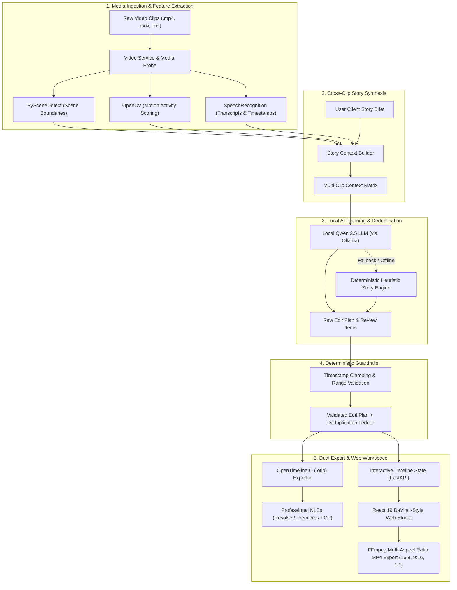

# EditMind AI — Autonomous Video Editing Pipeline with OpenTimelineIO & Local Qwen 2.5

[](https://www.python.org/downloads/)
[](https://fastapi.tiangolo.com)
[](https://react.dev)
[](https://opentimelineio.readthedocs.io/)
[](https://ollama.com/library/qwen2.5)
[](LICENSE)

> **Built for RYHATHON 2026** — An intelligent, privacy-first, non-destructive AI video editing pipeline that turns raw footage and creative briefs into **editable OpenTimelineIO timelines**, giving editors instant assembly without taking away creative control.

---

## 💡 The Core Problem & Our Solution

### The Problem
- **Generative AI Black Boxes**: Existing AI video tools produce *flattened MP4 files*. If an edit is slightly off, the editor has to discard the result or manually slice up rendered pixels without handles, audio stems, or source metadata.
- **Wasted Editor Hours**: Modern creators and commercial teams shoot hours of footage with multiple takes, false starts, and redundant B-roll. Sifting and assembling an initial rough cut consumes 60–80% of project time.
- **Privacy & Recurring API Tax**: Sending gigabytes of sensitive, unreleased footage and transcripts to cloud LLM APIs introduces latency bottlenecks, privacy risks, and high per-minute costs.

### Our Solution
1. **Multi-Clip Ingest & Semantic Feature Extraction**: Ingests raw video clips, detects scenes (PySceneDetect), measures visual motion (OpenCV), and transcribes dialogue (SpeechRecognition).
2. **Context-Aware Global Planning via Local Qwen 2.5**: Synthesizes all clip segments into a unified narrative context against a client story brief. Our local Qwen 2.5 model identifies narrative roles (hook, dialogue, B-roll, outro), weeds out repeated takes, and plans an optimal edit sequence.
3. **Deterministic Guardrails & Timestamp Validation**: Programmatic validation clamps ranges, verifies media boundaries, and routes borderline takes to a review ledger.
4. **Non-Destructive OpenTimelineIO (`.otio`) Export**: Generates an industry-standard, track-based `.otio` timeline that opens directly in **DaVinci Resolve**, **Adobe Premiere Pro**, and **Final Cut Pro**.
5. **Precision DaVinci-Inspired Web Workspace**: Includes a built-in dark-mode editor with SMPTE timecode, stereo VU meters, blade/trim tools, and a conversational AI Assistant for real-time timeline tweaking.

---

## 📐 Architecture & Pipeline Flow



---

## 📂 Repository Structure

```
RYHATHON - 2026/
├── EditAI/                          # Full-Stack Application
│   ├── backend/                     # FastAPI Backend Server
│   │   ├── app/
│   │   │   ├── database/            # SQLite persistence (db.py)
│   │   │   ├── models/              # Pydantic schemas (schemas.py)
│   │   │   ├── pipeline/            # Integrated AI pipeline modules
│   │   │   │   ├── ingest.py        # Media probing & duration validation
│   │   │   │   ├── model_adapter.py # Qwen 2.5 & offline story planner
│   │   │   │   ├── context_builder.py# Cross-clip context synthesizer
│   │   │   │   ├── validate.py      # Range & timestamp validation
│   │   │   │   └── export_otio.py   # OpenTimelineIO timeline export
│   │   │   ├── routes/              # REST API route controllers
│   │   │   │   ├── pipeline.py      # Endpoints for multi-clip pipeline & OTIO
│   │   │   │   ├── assembly.py      # AI Auto-Assemble endpoints
│   │   │   │   ├── chatbot.py       # Conversational timeline editing
│   │   │   │   ├── media.py         # Media pool uploads & sample packs
│   │   │   │   └── export.py        # FFmpeg multi-ratio MP4 rendering
│   │   │   └── services/            # Video, Speech, and AI model adapters
│   │   ├── tests/                   # Backend automated test suites
│   │   │   ├── test_assembly.py     # Multi-clip AI assembly test
│   │   │   ├── test_persistence.py  # SQLite project persistence test
│   │   │   └── test_workflow.py     # End-to-end split/delete/export test
│   │   ├── requirements.txt         # Backend Python dependencies
│   │   └── run.py                   # Uvicorn backend server entry point
│   ├── frontend/                    # DaVinci-Inspired React 19 Frontend
│   │   ├── src/                     # React components, state, & hooks
│   │   └── dist/                    # Pre-compiled production bundle
│   ├── run_app.py                   # Full-stack launcher (port management & browser launch)
│   ├── start.bat                    # Windows double-click launcher
│   └── requirements.txt             # Root requirements mirror
│
├── EDIT-AI-PIPELINE--main/          # Standalone Modular Pipeline Core
│   ├── app/
│   │   ├── ingest.py                # Source clip registration
│   │   ├── context_builder.py       # Structured narrative prompt generator
│   │   ├── model_adapter.py         # Local LLM adapter with Qwen 2.5 detection
│   │   ├── pipeline.py              # Main 5-stage pipeline orchestrator
│   │   └── export_otio.py           # Native OpenTimelineIO exporter
│   └── requirements.txt             # Standalone pipeline dependencies
│
├── README.md                        # Master Project Documentation (this file)
└── RUN_GUIDE.md                     # Step-by-Step Setup and Execution Manual
```

---

## ⚡ Quick Start

For detailed step-by-step instructions, see the **[Run Guide (RUN_GUIDE.md)](file:///c:/Users/user/Desktop/RYHATHON%20-%202026/RUN_GUIDE.md)**.

### 1. Install Dependencies
```bash
# In PowerShell or Terminal:
python -m venv .venv
.venv\Scripts\activate       # Windows PowerShell
# source .venv/bin/activate  # macOS / Linux

pip install -r EditAI/backend/requirements.txt
```

### 2. (Optional) Run Qwen 2.5 Locally with Ollama
If you want live LLM inferences (otherwise our deterministic offline fallback engine runs automatically):
```bash
ollama run qwen2.5:7b
```

### 3. Launch Options

#### Option A: Unified Full-Stack (Default)
```bash
# 1-Click Windows batch file:
.\start.bat
# or
python run_all.py
```
> Serves the compiled frontend and FastAPI backend together at **`http://127.0.0.1:8000`**.

#### Option B: Split Run (Frontend & Backend Separately)
```bash
# 1-Click Split Launcher (Opens two independent terminal windows):
.\run_separate.bat
# or in PowerShell:
.\run_separate.ps1
```

* **Or run manually in two terminals:**
  * **Terminal 1 (Backend)**: `.\run_backend.bat` or `python run_backend.py` (FastAPI at `http://127.0.0.1:8000`)
  * **Terminal 2 (Frontend)**: `.\run_frontend.bat` or `cd EditAI/frontend && npm run dev` (Vite at `http://localhost:5173`)

---

## 🎬 Key Features

### 1. Autonomous Multi-Clip AI Assembly
- Upload any number of clips or click **"Load 3-Clip Demo Pack"**.
- Provide a creative brief (e.g., *"Create an energetic commercial highlight reel highlighting the key benefits"*).
- The pipeline scans all footage, assigns semantic roles (`introduction`, `action_broll`, `benefit`, `presentation`, `outro`), drops duplicate takes, and generates an assembly with transparent editorial rationales.

### 2. OpenTimelineIO (`.otio`) Lossless Export
- Download `.otio` files directly from `/projects/{project_id}/timeline`.
- Retains clip names, media source URIs, source in/out cuts, track structures, and AI metadata tags.
- Open seamlessly in Premiere Pro, DaVinci Resolve, or Final Cut Pro.

### 3. DaVinci Resolve-Inspired NLE Web Interface
- **SMPTE Timecode**: Frame-accurate transport (`00:00:00:00`), stepping by 1 frame or 1 second.
- **Stereo VU Meter**: Dynamic audio metering from `0 dB` to `-50 dB`.
- **Multi-Track Timeline**: Dedicated tracks for `V1` (Video), `A1` (Audio), and `Sub1` (Subtitles) with Solo, Mute, and Lock.
- **Editorial Tools**: Split/Blade (`S`), Ripple Delete (`Del`), selection tool, and playhead snapping.
- **Inspector Panel**: In-depth clip inspector displaying speed (0.25x - 3.0x), volume, in/out points, and AI selection rationale.

### 4. Natural-Language AI Assistant
- Type conversational editing commands into the AI assistant:
  - *"Select the clip from 00:05 to 00:15."*
  - *"Split at 00:08."*
  - *"Delete the selected segment."*
  - *"Undo the last edit."*
  - *"Export as 9:16 vertical video for Instagram Reels."*

### 5. Multi-Aspect Ratio FFmpeg Rendering
- Export final edits in **16:9 Landscape**, **9:16 Vertical** (Center Crop or Letterbox Fit), or **1:1 Square**.
- Automatic subtitle burn-in and audio track normalization.

---

## 🧪 Automated Test Suite

Verify your installation by running the backend automated tests:

```bash
cd EditAI

# 1. Multi-clip AI sequence assembly test
python backend/tests/test_assembly.py

# 2. End-to-end editing workflow & FFmpeg export test
python backend/tests/test_workflow.py

# 3. SQLite persistence & project reload test
python backend/tests/test_persistence.py
```

---

## 📡 REST API Reference

| Method | Endpoint | Description |
| :--- | :--- | :--- |
| `POST` | `/projects` or `/api/pipeline/projects` | Multipart upload of video clips + client brief; runs full 5-stage pipeline and returns OTIO path & interactive timeline state. |
| `POST` | `/api/pipeline/run-existing` | Runs the 5-stage pipeline on existing media pool assets with custom brief. |
| `GET` | `/projects/{project_id}/timeline` | Downloads the generated `.otio` timeline file. |
| `GET` | `/projects/{project_id}/edit-plan` | Returns the raw model and validated JSON edit decisions. |
| `POST` | `/api/assembly/analyze-and-assemble` | Assembles a sequence from media pool clips using specified narrative styles. |
| `POST` | `/api/assembly/sample-pack` | Generates or loads the multi-clip testing demo pack. |
| `POST` | `/api/chatbot/command` | Natural-language conversational edit command processor. |
| `POST` | `/api/export/render` | Renders the timeline into a downloadable MP4 (16:9, 9:16, 1:1). |
| `GET` | `/api/health` | Health-check endpoint verifying backend status and storage directories. |

---

## 👥 Hackathon Team & Acknowledgments
- **Hackathon**: RYHATHON 2026
- **Project**: EditMind AI / EditAI Video Pipeline
- **Core Technologies**: OpenTimelineIO, Qwen 2.5 (Alibaba / Ollama), FastAPI, React 19, PySceneDetect, OpenCV, FFmpeg
